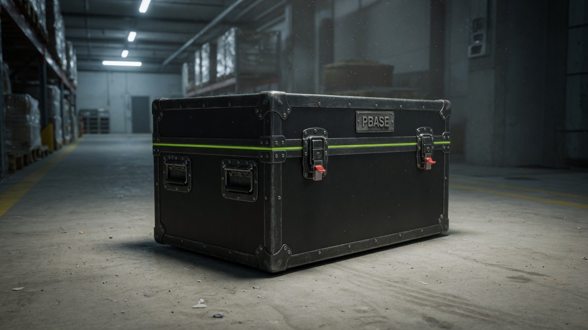

# Portabase

**Your Supabase Escape.** An Apache-2.0 disaster-recovery and migration engine that captures an entire Supabase project — **PostgreSQL roles, schema, and data**, **Auth inventory**, **Storage object bytes**, and **Edge Function source** — seals it into an **AES-256-GCM encrypted capsule**, and stores it in **your** vault.

If a dashboard is locked, a billing card fails, or a region goes down, official platform backups remain behind that login. A Portabase capsule is already in another building — ready to replay and verify into a fresh Supabase project.

[Website](https://portabase.dev) · [Documentation](https://portabase.dev/docs) · [Security & Threat Model](https://portabase.dev/security) · [Open Core](docs/OPEN_CORE.md) · [CLI Scenarios](docs/CLI-SCENARIOS.md)

[](LICENSE)
[](https://github.com/data-automation-ai/portabase.dev/actions/workflows/ci.yml)

<p align="center">
  
</p>

<p align="center"><em>A capsule is not a backup you can only reach if the landlord still lets you in.</em></p>

---

## Community CLI vs. Portabase Cloud

| Capability | **Community CLI (Apache-2.0)** | **Portabase Cloud (`$0` / `$7` / `$17`)** |
| :--- | :--- | :--- |
| **Capture, encrypt, verify, restore, replay** | Full engine — no license gate | Same open-source engine |
| **Where the job runs** | Your machine, VM, NAS, or CI | Local runner or managed Cloud runners |
| **Where the capsule lives** | **Your** S3, Dropbox, Google Drive, or disk | **Your** S3, Dropbox, Google Drive, or Local Starter (Cloud never hosts capsule bytes) |
| **Visual console, sizing planner, alerts** | Local read-only UI (`portabase ui`) | Hosted console, unattended restore, SMS alerts (**$0 Cloud Free** ≤ 40 GB · **$7/mo Starter Escape** 1 DB ≤ 10 GB · **$17/mo Daily Escape** unlimited DBs ≤ 25 GB) |
| **If `portabase.dev` disappears** | You keep the CLI and your encrypted capsules | Convenience is gone; your Escape is intact |

> *Portabase is an independent open-source project and is not affiliated with Supabase, Inc. Separate Supabase Vector Buckets are outside Portabase's scope.*

---

## What Is Inside a Capsule

| Layer | Official Platform Backup | Portabase Capsule |
| :--- | :--- | :--- |
| **PostgreSQL roles, schema, RLS policies, triggers, functions, and table rows** | Yes | **Yes** (`roles.sql`, `schema.sql`, `data.sql` + exact row & object inventory) |
| **Auth users & identity inventory** | Behind the same login | **Yes** (`auth.users` + `auth-inventory.json`) |
| **Storage files (actual object bytes)** | **No** — metadata only | **Yes** (SHA-256 verified object payloads + MD5 name/size inventory fingerprint) |
| **Edge Function source & config** | **No** | **Yes** (`functions-manifest.json`, source trees, and legacy `ESZIP` extraction) |
| **Restorable into a brand-new project** | **No** | **Yes** — guarded restore & replay with post-restore readback verification |

Every capture produces a signed **manifest** (`COMPLETE` / `PARTIAL` / `FAILED`) and SHA-256 checksum ledger. Recovery proof is an automated readback verification against a blank target project (`RESTORE_VERIFIED` / `SELECTIVE_RESTORE_VERIFIED`).

---

## Supported Storage Destinations (BYO Vault)

Portabase never holds your recovery archives. Capsules are encrypted before transfer and written directly to your storage:

- **Amazon S3 (`aws`):** Direct S3 upload with post-upload sync verification.
- **Dropbox (`dropbox`):** Native Dropbox API v2 connector (`DROPBOX_ACCESS_TOKEN` or OAuth2 refresh token) with chunked upload sessions and cryptographic verification against Dropbox's 4 MB block SHA-256 `content_hash` (plus `rclone` fallback).
- **Google Drive (`google-drive`):** Native Google Drive API v3 connector (`GOOGLE_DRIVE_ACCESS_TOKEN` or OAuth2 refresh token) with automatic `/Portabase/<capsuleId>` folder resolution and server-computed `sha256Checksum` verification (plus `rclone` fallback).
- **Local Starter (`local`):** Encrypted capsules on local disk, USB, or NAS (enforced ≤ 100 MB per capsule unless `--allow-large-local` is explicitly passed).

---

## Quick Start

**Prerequisites:** Node.js 20+, `pg_dump` and `psql` on `PATH`, and credentials for your source Supabase project.

```bash
# Install globally from npm
npm install -g portabase

# Or run from source
git clone https://github.com/data-automation-ai/portabase.dev.git
cd portabase.dev
npm install

# 1. Initialize configuration (writes portabase.config.json — never commit secrets)
portabase init

# 2. Validate tools, credentials, and destination connectivity
portabase doctor
portabase plan
portabase ui              # Launch local read-only sizing & capsule inspection GUI

# 3. Capture and seal a full encrypted capsule
portabase backup

# 4. Verify capsule integrity offline (no target project required)
portabase verify --capsule ./portabase-capsules/<capsule-id>
portabase simulate --capsule ./portabase-capsules/<capsule-id>

# 5. Build a selective restore plan (e.g. to fit a 500 MB free-tier test target)
portabase restore-plan --capsule ./portabase-capsules/<capsule-id>

# 6. Execute a guarded restore into a NEW blank Supabase project
portabase restore \
  --capsule ./portabase-capsules/<capsule-id> \
  --execute \
  --confirm-target <NEW_TARGET_PROJECT_REF>
```

Set `PORTABASE_ENCRYPTION_PASSPHRASE` (≥ 16 characters) alongside your `SUPABASE_*` and `PORTABASE_TARGET_*` variables in a gitignored `.env.portabase.local` file.

---

## Security & Zero-Knowledge Cryptography

- **Capsule Encryption ([`utility/capsule-crypto.mjs`](utility/capsule-crypto.mjs)):** Key derivation via `scrypt` (`N=16384, r=8, p=1`) into **AES-256-GCM** authenticated encryption with SHA-256 verification over both ciphertext (`capsule.enc`) and inner manifest (`manifest.json`).
- **Ephemeral Runner Sealing ([`cloud/runner/sealed-credential-open.mjs`](cloud/runner/sealed-credential-open.mjs)):** Ephemeral **X25519 + HKDF-SHA256 + AES-256-GCM** credential envelopes with strict 5-minute TTL and single-use replay protection.
- **Anti-Clobber Target Guards ([`utility/portabase-core.mjs`](utility/portabase-core.mjs)):** Restore refuses to execute if `targetRef === sourceRef`, requires `--confirm-target` host verification, and enforces a blank-target preflight (`applicationTables=0, authUsers=0, storageBuckets=0, edgeFunctions=0`) before writing.
- **Privacy Guarantee:** No analytics on the public site, no plaintext credentials or passphrases in logs or recovery evidence, and opt-in health-metadata-only telemetry. See [docs/SECURITY-TRUST.md](docs/SECURITY-TRUST.md) and [docs/KEY-PROTECTION.md](docs/KEY-PROTECTION.md).

---

## Repository Structure

```text
portabase.dev/
├── utility/                  # Core CLI engine, AES-256-GCM crypto, S3/Dropbox/GDrive connectors
├── src/                      # Vite + React marketing site, docs app, and Portabase Cloud GUI console
├── netlify/                  # Cloud control-plane serverless functions & shared auth/Square modules
├── cloud/                    # Isolated runner supervisor, sealed credential opener, and control plane
├── desktop/                  # Electron desktop wrapper (Windows 11)
├── supabase/                 # Control-plane PostgreSQL schema migrations & RLS policies
├── scripts/                  # Operational utilities and automated E2E verification scripts
├── tests/                    # 800+ unit, security, and integration tests
└── docs/                     # Architecture, runbooks, CLI scenarios, and threat model documentation
```

## Development & Testing

```bash
npm test         # Run the full 800-test suite (unit, crypto, security, and connector tests)
npm run dev      # Start local Vite marketing site + Cloud GUI console + API middleware
npm run build    # Build production client bundle
```

---

## Documentation Index

| Topic | Documentation |
| :--- | :--- |
| **CLI Recipes & Selective Restore** | [docs/CLI-SCENARIOS.md](docs/CLI-SCENARIOS.md) · [docs/FREE-CLI.md](docs/FREE-CLI.md) |
| **Operator Runbook & Replay Proof** | [docs/ESSENTIALS_RUNBOOK.md](docs/ESSENTIALS_RUNBOOK.md) · [docs/REPLAY.md](docs/REPLAY.md) · [docs/RESTORE_DRILL.md](docs/RESTORE_DRILL.md) |
| **Security, Keys & Threat Model** | [docs/SECURITY-TRUST.md](docs/SECURITY-TRUST.md) · [docs/KEY-PROTECTION.md](docs/KEY-PROTECTION.md) |
| **Open-Core Model & Cloud Architecture** | [docs/OPEN_CORE.md](docs/OPEN_CORE.md) · [docs/CLOUD.md](docs/CLOUD.md) · [docs/CLOUD_INFRASTRUCTURE.md](docs/CLOUD_INFRASTRUCTURE.md) |
| **Cloud Plans & Square Billing** | [docs/BILLING.md](docs/BILLING.md) · [docs/TELEMETRY_SCHEMA.md](docs/TELEMETRY_SCHEMA.md) |
| **Contributing & Security Disclosure** | [CONTRIBUTING.md](CONTRIBUTING.md) · [CODE_OF_CONDUCT.md](CODE_OF_CONDUCT.md) · [SECURITY.md](SECURITY.md) |

## License

[Apache License 2.0](LICENSE) · Copyright © 2026 [DataAutomation.ai, LLC](https://github.com/data-automation-ai)

